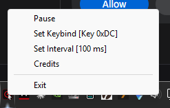
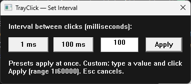

# TrayClick

## TL;DR

A tiny Windows tray auto clicker. TrayClick sits in the notification area with no main window. Press the keybind (default **F6**) and it clicks at your cursor at the set interval (default **100 ms**), indefinitely, until you press the keybind again. Left- or right-click the tray icon for a menu with exactly six options: **Pause/Resume**, **Set Keybind**, **Set Interval**, **Start with Windows**, **Credits**, and **Exit**. That's the whole program.

- Windows 10 or later, x64
- One small executable (installer or portable); the keybind and interval are all you have to set
- The keybind and interval you pick are remembered between runs (`%APPDATA%\TrayClick\config.json`)

## Download

Every [release](https://github.com/SeanShaffer88/TrayClick/releases) provides exactly two downloads:

- **Installer** — `TrayClick-Setup-v<version>-x64.exe`: per-user install (no admin), Start menu shortcut, uninstaller in Windows Settings. Your settings survive uninstall; they're in `%APPDATA%\TrayClick`.
- **Portable zip** — `TrayClick-v<version>-portable.zip`: the portable exe, the license, and a short portable note. No install — unzip, run the exe from anywhere.

The builds are unsigned, so Windows SmartScreen may warn on first run: "More info" → "Run anyway".

## How to use

1. Run TrayClick (installed shortcut, or the portable exe). It appears in the system tray (notification area) — you may need the `^` overflow arrow the first time.
2. Press **F6** to start auto-clicking at the cursor. Press **F6** again to stop.
3. Click the tray icon (left or right click — both work) for the menu:
   - **Pause** — stops clicking immediately and ignores the keybind. The item becomes **Resume**; resuming does not restart clicking until you press the keybind again.
   - **Set Keybind [F6]** — opens a small window; press any key to make it the new toggle key (`Esc` cancels). The primary mouse buttons can't be assigned, but the side buttons (X1/X2) can. Assigning a key never starts clicking by itself — clicking starts when you press the new keybind again.
   - **Set Interval [100 ms]** — opens the settings window, which has three tabs. **Clicking:** **1 ms** and **100 ms** preset buttons or a custom interval (1–60000), the **mouse button** (left, right, or middle), **jitter** (varies each interval by up to ±10%), the **mode** (Click; Hold — the keybind holds the button down until pressed again; or Momentary — clicking runs only while the keybind is held), the **target** (Follow the cursor, Locked to a fixed point, or a Sequence of points), an **auto-stop limit** (stop after N clicks per run; 0 = no limit), **start on launch** (clicking begins when TrayClick starts, click mode only), a **stop-only key** (a second binding that only stops), optional **registered hotkeys** instead of polling, a **delayed start** (begin clicking in N minutes), a **foreground-app rule** (cycles run only while a chosen app is in front; pick it from your running windows), and **fullscreen auto-pause**. **Action:** the **click action** — Single, Double, a Burst of up to 100 clicks with a configurable gap, **Scroll** (wheel notches per cycle), **Key** (repeats a captured keystroke), or **Drag** (presses at one point you pick on screen and glides to another) — a **button-down time** (how long each click holds the button, 0–1000 ms), **alternating buttons** (consecutive clicks alternate Left/Right), a **random interval range** (each cycle picks between the interval and a max), and a **speed ramp** (the interval eases to a target over the first seconds of each run). **Targeting:** pick the lock point by clicking anywhere on screen, save it into **named slots**, jump it to the **other monitor's centre**, make it follow its window (**window-relative**), add a pixel **offset**, a **pixel check** (click only while a watched pixel keeps its colour), and a **region guard** (stop the run when the screen around the point changes).
   - **Start with Windows** — checked when TrayClick is set to launch at sign-in (per-user, no admin). Uncheck to stop launching. If you use the portable exe, the entry points at wherever the exe is, so moving it means toggling this once more.
   - **Credits** — version, current settings, and how many clicks this session has fired.
   - **Exit** — removes the tray icon and quits.

While clicking is on in the default Follow target, clicking follows your cursor — it clicks wherever the pointer currently is, at the set interval, including if you move it. With the **Locked** target, each click jumps to the lock point (one you picked on screen, or the spot where clicking started if you never picked one), clicks, and puts your cursor back where you left it, so you can keep working elsewhere. With the **Sequence** target, clicks rotate through up to four points you picked, one per cycle. In **Hold** mode the keybind holds the button down instead — and every way of stopping (keybind, Pause, a dialog, the failsafe, Exit) releases it. You can always tell it's on: **the tray icon blinks** (alternating with an inverted red icon) and its tooltip shows the click count or the held button.

**Safety:** while clicking is on, slam the mouse into the **top-left corner of the screen** to stop clicking instantly — handy at fast intervals, before you reach for the keybind.

## Notes

- Only one copy runs at a time; starting a second copy just tells you it's already running. Unless you give it a command: `TrayClick.exe --start`, `--stop`, or `--toggle` forwards the command to the running copy and exits (with no copy running, `--start`/`--toggle` launch it already clicking). `--profile <name>` forwards a profile name the same way — profiles arrive in v1.0.0.
- TrayClick clicks with the standard Windows `SendInput` API at the current cursor position. It does not move the cursor, record anything, or phone home. It works completely offline.
- The click interval defaults to 100 ms and can be set to 1 ms, 100 ms, or any custom value from 1 to 60000 ms in the Set Interval window. Very small intervals click as fast as Windows can deliver them; the effective rate is bounded by the OS timer and message delivery.
- Settings — keybind, stop key, hotkey mode, interval, mouse button, jitter, mode, target, lock point, sequence points, named slots, click offset, pixel check, region guard, foreground app, fullscreen pause, auto-stop limit, start-on-launch, action, burst count/gap, button-down time, alternation, scroll amount, repeat key, drag points, random range, and ramp — are saved in `%APPDATA%\TrayClick\config.json` and survive restarts. Config files from every earlier version load unchanged. (The delayed start is the one exception: it's a one-shot countdown and is never saved.)
- TrayClick is per-monitor DPI aware, so locked-position clicks land exactly on scaled (e.g. 150%) displays.

## Screenshots

The tray menu (captured on v0.3.1; v0.4.0 adds a sixth item, **Start with Windows**), with the current keybind and interval shown in brackets:



The settings window (captured on v0.3.1; it has grown since — 0.4.0 added the mouse-button row and jitter toggle, 0.5.0 the mode/target row, the auto-stop limit, and start-on-launch, 0.6.0 the click-action section, 0.7.0 the repeat-key/drag buttons and the timing section, and 0.8.0 split it into Clicking / Action / Targeting tabs):



More captures from a real run are on the way; see [docs/screenshots/CAPTURE.md](docs/screenshots/CAPTURE.md) for the exact shots still needed.

## Build from source

```powershell
cargo build --release
cargo test
```

Requires a current stable Rust toolchain on Windows. The icon in `assets/icon.ico` is embedded as a Windows resource at build time; regenerate it with `python3 assets/make_icon.py` (needs Pillow).

## License

MIT — see [LICENSE](LICENSE).
